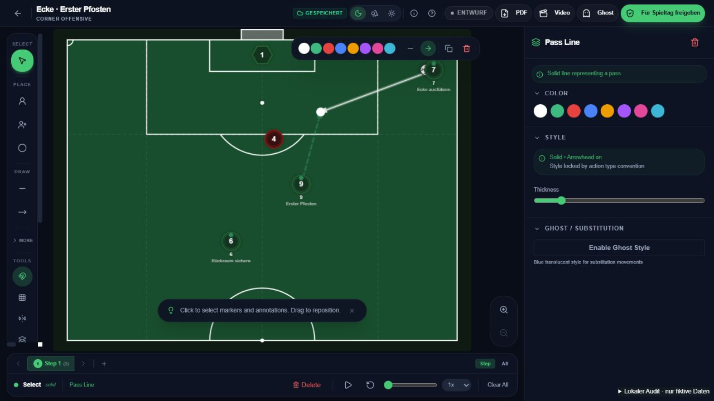
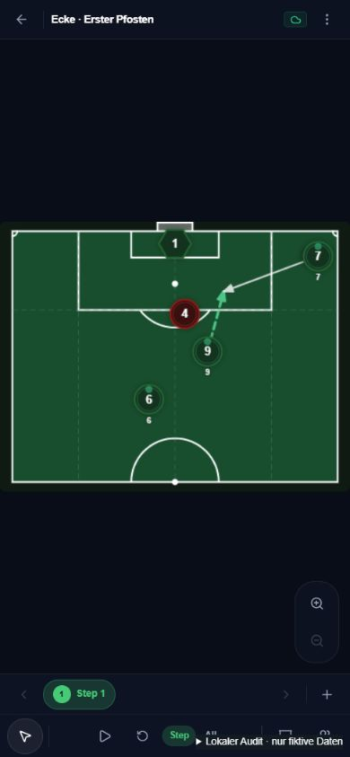

# SETPIECE: Editor-Audit und Umsetzungsplan

Stand: 31. Oktober 2026. Gegenstand: Zeichnen, Korrigieren, Greifen, Kontrast, Tastatur und taktische Verständlichkeit.

**Empfehlung: zuerst den bestehenden Zeichenablauf zuverlässig und schnell machen. Danach Gegnerreaktionen und echte Varianten ergänzen.** Die Probleme sind teilweise reproduzierbare Bedienfehler. Zusätzliche Werkzeuge allein würden sie nicht lösen.

## Prüfumfang und Grenzen

- Originalkomponente `SetPieceEditor` mit Original-Canvas, Werkzeugen, Inspektor, Phasenleiste und Tastaturbehandlung lokal bedient. Stand: main `1fbf225f8635749271876d6a185eda1b1400befe`.
- Ausschliesslich das bereits vorhandene fiktive Demoteam, ergänzt um fiktiven Gegner, Torwart und Ball. Ein Entwicklungseinstieg ersetzt API-Aufrufe durch Antworten im Arbeitsspeicher. Neuladen verwirft alle Änderungen. Keine Produktionskonten oder Datenbank verwendet.
- Browser: 1280 × 720 und 390 × 844 CSS-Pixel. Die schmale Ansicht wurde mit Maus bedient; eine physische Touch-, Stift- oder Outdoor-Abnahme steht aus.
- Unabhängige Codeprüfung und fachliche Trainerprüfung durch zwei Agenten; Browserprüfung durch den koordinierenden Agenten. Impeccable im Modus Operate und Investigate für die Ursachenprüfung verwendet.
- Keine Änderungen am ausgelieferten Editor, kein Deployment, keine bezahlten Replit-Agentaufträge. Keine Prüfung von Anmeldung, dauerhafter Speicherung oder Live-Export in diesem Lauf.

## Wichtigste Befunde

| Priorität | Beobachtung | Auswirkung für Trainer | Empfohlene Änderung |
| --- | --- | --- | --- |
| P1 | Ausgewählte Passlinie am Linienkörper gezogen: Position bleibt unverändert. | Das natürliche «anklicken und verschieben» scheitert genau nach der Auswahl. | Linienkörper bewegt die ganze Linie; Endgriffe bewegen einzelne Punkte. Auswahl beim Dragstart setzen. |
| P1 | `R`, auf eigenen Spieler klicken, Ziel klicken, Enter: kein neuer Laufweg; nur ein Zeichenpunkt. | Der naheliegende Einstieg am Spieler wird als Auswahl behandelt. | Zeichenmodus hat Vorrang: Spieler ist Startanker, Ziel ist Endpunkt. Marker nur im Auswahlmodus bewegen. |
| P1 | Untere Farbauswahl ändert bei gewählter Linie nur die Voreinstellung; schwebende Farbauswahl ändert die Linie. | Identische Farben versprechen dieselbe Wirkung und tun etwas anderes. | Eine gemeinsame Eigenschaftsaktion: mit Auswahl diese ändern; ohne Auswahl die nächste Zeichnung. |
| P1 | Nicht gewählte Wege werden auf 30 %, andere Marker auf 35 % Deckkraft reduziert. | Mitspieler, Gegner und Anschlussaktionen sind beim Bearbeiten schwer lesbar. | Auswahl durch Kontur, Griffe und kurze Beschriftung hervorheben. Kontext im normalen Bearbeitungsmodus voll sichtbar lassen. |
| P1 für Gegnerabläufe | Gegner in Phase 2 verschoben: nach Rückkehr zu Phase 1 ebenfalls verschoben. | Die Ausgangssituation geht verloren; Gegneranpassungen lassen sich nicht sauber erzählen. | Positionen aller taktischen Objekte je Phase speichern, einschliesslich Gegner, Torwart und Ball. |
| P2 | `Esc` verwirft Zeichenpunkte/Auswahl, lässt aber das Zeichenwerkzeug aktiv. | Der nächste Klick kann erneut zeichnen statt auswählen. | `Esc` bricht die aktuelle Aktion ab und führt zur Auswahl zurück. Optionaler Mehrfachzeichenmodus muss ausdrücklich sichtbar sein. |
| P2 | Viele Beschriftungen bleiben englisch: Select, Draw, Step, All, Pass Line, Tactical Notes. Shortcuts stehen nicht an Werkzeugen. | Trainer müssen Begriffe und unsichtbare Bedienregeln lernen. | Durchgehend deutsche Trainerbegriffe; Kürzel direkt in Werkzeugtipps und eine kompakte Hilfe. |
| P2 | Mobile Werkzeugwahl ist hinter einem unbeschrifteten Symbol verborgen. Einige Farbfelder am Desktop sind 20 × 20 px und ohne zugänglichen Namen. | Auffinden und präzises Treffen sind unnötig schwierig. | Sichtbare Hauptaktionen Auswahl/Lauf/Pass; benannte Farbfelder, grössere Trefferflächen. Für Touch 44–48 px als Produktziel. |

P1 bedeutet erhebliche Behinderung des Kernablaufs; P2 bedeutet Reibung mit einem vorhandenen Umweg. Die fehlenden Varianten sind eine Produktlücke, kein Beleg dafür, dass die heutige App diese Funktion bereits verspricht.

### Weitere Befunde aus dem Code

Diese Punkte sind von den oben nachgestellten Browserfällen zu unterscheiden:

- **P1 · Einrasten ist widersprüchlich.** Beim Fertigstellen wird die Markersuche unabhängig vom Snap-Schalter ausgeführt. Nach manuellem Verschieben eines Endpunktes bleibt dessen alte Markerbindung bestehen. Ein später verschobener Spieler kann den Endpunkt wieder mitnehmen. Lösung: Schalter überall beachten; bewusst gelöste Endpunkte entkoppeln und Verbindungen sichtbar machen.
- **P1 · Laufwegzuordnung kann fachlich falsch sein.** Freie Laufwege werden in der Animation teilweise über Listenpositionen zugeordnet. Gemischte verbundene/freie Wege können dadurch nicht oder falsch animieren. Laufwege explizit Rollen zuordnen; eine freie Zeichnung darf keinen zufälligen Spieler bewegen.
- **P2 · Wirkungslose Stiloptionen.** Die schwebende Leiste bietet «Pfeil entfernen» und durchgezogen/gestrichelt an. Der Renderer erzwingt bei Lauf und Pass trotzdem Pfeil und jeweilige Linienart. Im Browser wurde die Zustandsänderung bestätigt; die erzwingende Darstellung wurde im Code geprüft. Besser «In Pass/Lauf umwandeln» anbieten und die Semantik einheitlich darstellen.
- **P2 · Schwebende Leiste benutzt eine andere Positionsberechnung.** Sie berücksichtigt die tatsächliche Feldtransformation mit Padding, Zoom und Pan nicht vollständig. Position aus derselben Transformation wie Canvas und Endpunktgriffe ableiten; gesonderte Zoom-/Pan-Abnahme erforderlich.
- **P1 für mehrphasige Taktiken · Phase löschen verschiebt Linien stillschweigend in die erste verbleibende Phase.** Dadurch können Aktionen überlagert werden. Stattdessen explizit «Phase mit ihren Aktionen löschen» oder «Aktionen nach … verschieben» anbieten, mit Undo.

## Was beim Bedienen bereits funktioniert

| Ablauf | Ergebnis |
| --- | --- |
| Linienendpunkt greifen und danach Strg+Z | Endpunkt verschiebbar; Rückgängig stellt die vorige Geometrie wieder her. |
| Zwei freie Feldpunkte klicken und Enter | Neuer Laufweg entsteht. Das Problem betrifft insbesondere den Einstieg am Marker und die fehlende Ziehgeste. |
| Schwebende Farbauswahl | Bestehende Passlinie wird tatsächlich umgefärbt. |
| Radierer direkt auf den Linienkörper | Linie wird gelöscht; Strg+Z stellt sie wieder her. Der anfängliche Codeverdacht zum verschluckten Radierklick wurde verworfen. |
| Werkzeugkürzel R, V und E | Werkzeugwechsel funktioniert. |
| Wiederholen | Schaltfläche stellt eine rückgängig gemachte Zeichnung wieder her. Strg+Y und Strg+Shift+Z zeigten im verwendeten In-App-Browser keinen verifizierten Redo-Effekt; Browser-/Hosteinfluss ist nicht isoliert. Vor Freigabe in Chrome/Edge sowie auf macOS separat prüfen. |
| Schmale Ansicht | Feldproportionen bleiben erhalten, Werkzeugmenü öffnet sich. Kein Anlass, die korrekte Geometrie zu verzerren. |

Die vorhandenen Rollen, Vorlagen, Liniensemantik, Undo und metrische Feldgeometrie sind eine brauchbare Grundlage. Das Problem liegt vor allem in widersprüchlichen Bedienzuständen.

## Kontrast: konkrete Richtung

Die deklarierte Farbe des Demolaufwegs `#37d89a` hat auf dem dunklen Feld `#0a4d2e` rechnerisch ungefähr **5,42:1** Kontrast. Mit 30 % Deckkraft sinkt das bei einfacher Alpha-Verrechnung auf ungefähr **1,78:1**. Das ist eine Berechnung aus den Quellfarben, keine vollständige Pixel- oder WCAG-Zertifizierung. Die Auswahlabdunklung ist deshalb der erste Hebel.

Für bedeutungstragende Grafiken nennt W3C mindestens 3:1 Kontrast zu benachbarten Farben. Das muss für alle Feldthemen geprüft werden. Kleine Texte brauchen zusätzlich ihren eigenen Textkontrast. [W3C: Nicht-Text-Kontrast](https://www.w3.org/WAI/WCAG22/Understanding/non-text-contrast.html)

Vorgeschlagene Regeln:

- Eigene Spieler mit klarer heller Kontur, Gegner zusätzlich durch andere Form und Beschriftung unterscheiden. Nummern bleiben auch bei Auswahl gut lesbar.
- Lauf = gestrichelt, Pass = durchgezogen; helle kontrastreiche Standardfarben plus schmale dunkle Unterkontur auf hellem Feld. Farbe bleibt anpassbar.
- Auswahl hebt das Objekt hervor, ohne die übrige Taktik zu verstecken. «Nur meine Rolle» ist eine bewusste Spieleransicht und ein eigener Schalter.
- Zonen dürfen transparent sein, ihre Umrandung und Beschriftung bleiben sichtbar. Auswahlgriffe haben grössere unsichtbare Trefferflächen als ihre sichtbare Form.
- Mobile Leerflächen für relevante Hinweise und Aktionen nutzen; das Spielfeld weiterhin proportional einpassen.

## Zielablauf: schnell zeichnen und sofort korrigieren

1. Vorlage öffnen und Rollen platzieren. Rollenname, Nummer und Aufgabe bleiben dieselbe Identität.
2. `R` für Lauf oder `L` für Pass. Vom Spieler beziehungsweise Ball zum Ziel ziehen; loslassen beendet eine gerade Linie. Alternativ Start und Ziel klicken. Kurven behalten einen klaren Mehrpunktmodus.
3. Neue Linie ist direkt ausgewählt. Linienkörper verschiebt alles; Endgriffe ändern Start/Ziel; ein zusätzlicher Griff ändert die Kurve.
4. Farbe, Stärke und Typ an einem eindeutigen Ort ändern. Die Anpassung erscheint sofort auf dem Feld.
5. `Esc` zurück zur Auswahl. Eine Handlung entspricht einem Undo-Schritt; auch nach feiner Korrektur.
6. Vorschau zeigt genau das, was die Spieler anschliessend sehen.

Die Klickalternative bleibt wichtig: Draggen sollte die schnelle Möglichkeit sein, aber nicht die einzige. [W3C: Alternativen zu Ziehbewegungen](https://www.w3.org/WAI/WCAG22/Understanding/dragging-movements.html)

### Tastatur

| Aktion | Heute | Ziel |
| --- | --- | --- |
| Auswahl / Lauf / Pass | V / R / L vorhanden | Beibehalten, direkt am Werkzeug anzeigen |
| Spieler / Gegner / Ball | P / O / B vorhanden | Beibehalten |
| Kurvenlauf / Flanke | C / X vorhanden | Beibehalten, im erweiterten Menü erklären |
| Rückgängig / Wiederholen | Strg/Cmd+Z funktioniert; Redo-Kombinationen sind im Code vorgesehen, im IAB noch nicht erfolgreich abgenommen | Betriebssystemgerecht anzeigen; Gross-/Kleinschreibung normalisieren, Browser-/Hosteinfluss und alle Objekte prüfen |
| Präzise verschieben | Pfeile und Shift+Pfeile für Annotationen/Gegner/Ball | Auch für eigene Rollen; zusammenhängende Aktion sinnvoll bündeln |
| Fertig / letzten Punkt zurück | Enter / Backspace vorhanden | Sichtbar erklären |
| Abbrechen | Esc löscht Punkte/Auswahl | Zusätzlich zur Auswahl zurück |
| Duplizieren | Über Oberfläche vorhanden | Strg/Cmd+D im fokussierten Editor ergänzen |
| Hilfe | Keine gefundene Kürzelübersicht | Sichtbare «Tastaturkürzel»-Hilfe; optional ? |

Kürzel gelten nur bei aktivem Editor. Texteingaben, offene Dialoge und Browseraktionen dürfen sie nicht unbeabsichtigt auslösen. Der vorhandene Schutz für Input/Textarea/Contenteditable ist zu erhalten und um Dialog-/Fokusfälle zu prüfen.

## Taktik verständlich machen: Standard, Variante, Phase

**Standard → Variante → Phase** ist die empfohlene Struktur.

- **Standard:** «Ecke links» als gesamte gespeicherte Situation.
- **Variante:** eine alternative Lösung, beispielsweise «A – kurz» oder «B – freier Rückraum».
- **Phase:** zeitlicher Abschnitt innerhalb einer Variante, beispielsweise «Aufstellung → Gegner reagiert → Ausführung».
- **Gegnerhinweis:** was der Spieler beobachten soll.
- **Teamsignal:** vereinbarte Kommunikation innerhalb des eigenen Teams.
- **Auftrag:** was die konkrete Rolle jetzt tut.

Beispiel als Produktkonzept, vom Trainer taktisch festzulegen:

| Erkennen | Vereinbartes Teamsignal | Entscheidung |
| --- | --- | --- |
| Kurze Anspielstation ist anspielbar | «Arm hoch = A» | Variante A anzeigen und ausführen |
| Zweiter Verteidiger schliesst die kurze Option, anderer Raum wird frei | «Zeigen = B» | Variante B mit angepassten Aufgaben anzeigen |

Gegnerhinweis und Teamsignal müssen verschieden aussehen und verschieden heissen. Eine Geste hat keine allgemeingültige Bedeutung; sie wird vom Team vereinbart.

FIFA beschreibt bei Chelseas kurzen Ecken verschiedene Lösungen aus einer gemeinsamen Struktur abhängig von der gegnerischen Reaktion. Daraus leiten wir die Produktstruktur ab, keine allgemeingültige Spieltaktik für Amateur- oder Juniorenteams. [FIFA: Short corners – structure and decision-making](https://www.fifatrainingcentre.com/en/game/game-analysis/set-plays/set-play-routines/short-corners-structure-and-decision-making-in-chelseas-set-plays.php)

### So sollte die Oberfläche arbeiten

- Oben eindeutig «Ecke links · Variante A · Phase 2» anzeigen. Variantenwähler getrennt von der Phasenleiste halten.
- «Gegnerreaktion hinzufügen» kopiert die aktuelle Lösung in eine Alternative. Rollenidentitäten bleiben erhalten; nur Unterschiede werden geändert. Der Trainer kann den Entscheidungspunkt vor der Ausführung oder an einer benannten Phase festlegen.
- Pro Variante ein kurzer Hinweis «Wenn … → dann …», ein optionales Teamsignal und passende Rollenaufträge. Erst anzeigen, wenn eine Gegnerreaktion benötigt wird.
- Zunächst zwei bis drei Alternativen, keine verschachtelten Entscheidungsbäume. Immer eine Variante auf dem Feld bearbeiten. Eine Vergleichsansicht ist später möglich.
- «Alle Phasen abspielen» bleibt innerhalb der aktiven Variante. A und B dürfen nicht als zeitlich aufeinanderfolgende Aktionen abgespielt werden.
- Beim Teilen und Export müssen Variantenname, Phase, Gegnerhinweis, Signal und Spielerauftrag übereinstimmen.

### Signalfiguren

Die Idee ist sinnvoll. Zunächst kleine, klare Posen beziehungsweise Signalabzeichen am bestehenden Spieler: ein Arm hoch, beide Arme hoch, links/rechts zeigen und Blick-/Körperrichtung. Dazu ein kurzer frei benennbarer Text. Spielernummer und Rolle bleiben erkennbar.

Wiederverwendbare Vektorsymbole passen besser als detailreiche generierte Sticker: scharf bei jeder Grösse, gut umfärbbar und keine zusätzliche visuelle Unruhe. Figuren sind eine optionale Darstellungsweise. Gespiegelte Boards müssen Richtung und Beschriftung ebenfalls korrekt wiedergeben.

### Daten und Spielerquiz gemeinsam erweitern

Aktuelle Steps sind nur linear. Gegner, Torwart und Ball besitzen noch keine phasenbezogenen Positionen. Bereitschaft ist heute je Spieler und Standard gespeichert; Quizversuche kennen weder Variante noch veröffentlichte Inhaltsversion.

Vor einer Variantenfreigabe brauchen wir deshalb:

- Eindeutige Varianten- und Phasen-IDs, je Variante unabhängige Zeichnungen und Positionen sämtlicher Objekte. Bestehende Boards werden verlustfrei zu «Variante A» migriert; aktuelle Rollenidentitäten bleiben stabil.
- Variantenspezifische Rollenaufträge, gemeinsame Spielerzuweisung wo passend und keine zufällige Laufwegzuordnung.
- Veröffentlichung mit Inhaltsversion und festgelegten Pflichtvarianten. «A bestätigt» darf nicht automatisch «B verstanden» bedeuten. Relevante Änderungen öffnen die betroffene Bestätigung wieder.
- Verständnisfragen zum Erkennen und Entscheiden, zusätzlich zur eigenen Aufgabe. Das bleibt eine Lernrückmeldung und kein Nachweis der Ausführung auf dem Platz.
- Verlustfreies Laden/Speichern, Migration, Undo, Vorschau, Spieleransicht, PDF und Video als gemeinsame Abnahme.

## Umsetzungsreihenfolge

| Paket | Inhalt | Abnahme vor dem nächsten Paket |
| --- | --- | --- |
| 1 – Verlässliches Bearbeiten | Linienkörper/Griffe, konsistente Farben und Stilaktionen, Snap/Bindung, keine starke Abdunklung, explizite Laufwegzuordnung | Linie und Kurve greifen, korrigieren, rückgängig machen; nichts anderes verschiebt sich. Auswahl bleibt lesbar. |
| 2 – Schnelles Zeichnen | Start am Marker, direkte Ziehgeste plus Klickalternative, neue Linie auswählen, Esc/Shortcuts, deutsche Begriffe, mobile Hauptaktionen | Derselbe Ablauf bei Normalansicht, Zoom/Pan, schmalem Bildschirm und anschliessend echtem Touch. |
| 3 – Varianten und Gegnerreaktionen | Unabhängige Alternativen, phasenbezogene Gegner/Ball/Torwart, Variantenkopie, Rollenaufträge, Veröffentlichung/Quiz-Version | A kopieren, B verändern, A bleibt identisch; Speichern/Neuladen und alle Spieler-/Exportansichten stimmen überein. |
| 4 – Signale und Pilotfeinschliff | Kleine Gestenbibliothek, Richtung, verständliche Hinweise und Entscheidungsfragen | Trainer und Spieler erkennen Signal, Hinweis und passende Aktion ohne zusätzliche Erklärung. |

Alex koordiniert die Pakete. Mia übernimmt die Bedienoberfläche, Leo die reproduzierbaren Abnahmen, Nora Datenmodell/Migration und Berechtigungen. Ein klarer gemeinsamer Auftrag pro Paket; keine parallelen Änderungen an denselben Dateien. Replit-Guthaben gezielt für die spätere Integration und veröffentlichungsnahe Abnahme einsetzen; das Audit benötigte keinen bezahlten Replit-Agentlauf.

### Fünf Trainer als messbarer Produkttest

Jeder Trainer bearbeitet dieselben Aufgaben ohne vorgeführte Klickfolge: Vorlage öffnen, Lauf zeichnen, Endpunkt ändern, ganze Linie verschieben, Fehler rückgängig machen, Aufgabe zuordnen und Spieleransicht öffnen. Nach dem Variantenpaket: A kopieren, Gegner in B anpassen, zurück zu A, Signal und Entscheidung erklären.

Zeiten, Fehlklicks, unbeabsichtigte Objektbewegungen und Hilferufe erfassen. Vorgeschlagene Produktziele, noch keine gemessenen Ergebnisse: mindestens vier von fünf Trainern schaffen den einfachen Vorlagenablauf in drei Minuten; eine Linienkorrektur gelingt in zehn Sekunden; keine verlorenen Aktionen oder versehentlich veränderte andere Variante. Vorher/Nachher mit denselben Aufgaben vergleichen. Einen kleinen Pilot mit fünf Personen nicht als statistischen Marktnachweis ausgeben.

## Technische Belege und nächste Abnahme

| Ursache | Quellstelle |
| --- | --- |
| Auswahl deaktiviert Linienkörper-Drag | `AnnotationLayer.tsx:235,291` |
| Auswahlabdunklung | `AnnotationLayer.tsx:188–190`, `markers.tsx:55` |
| Marker greifen Klick vor Zeichnen ab | `markers.tsx:72–73`; `EditorCanvas.tsx:980,1103` |
| Untere Farben statt Auswahl | `BottomBar.tsx:428–453`; Gegenstück `ContextualMiniBar.tsx:133` |
| Renderer erzwingt Linienstil | `AnnotationLayer.tsx:196–199` |
| Snap/Verbindungsablösung | `EditorCanvas.tsx:357–361`; `editorStore.ts:263–292` |
| Aktuelle Shortcuts | `EditorCanvas.tsx:22–37,647–716`; `SetPieceEditor.tsx:349–357` |
| Gegnerposition global | `EditorCanvas.tsx:982–993` |
| Freie Laufwege/Animationszuordnung | `EditorCanvas.tsx:243–253`; `PlayerBoardViewer.tsx:225–241` |
| Phase löschen verschiebt Aktionen | `editorStore.ts:351–366` |
| Schwebende Leiste/Transformation | `ContextualMiniBar.tsx:66` |
| Heutiges Board-/Phasenmodell | `types.ts:34–87` |
| Bereitschaft/Quiz ohne Variante | `lib/db/src/schema/playerReadiness.ts:24`; `quizAttempts.ts:9`; `routes/quiz.ts:53–85` |

Die Editor-Dateien liegen unter `artifacts/setpiece/src/components/editor/`; Seiten unter `artifacts/setpiece/src/pages/`, Serverrouten unter `artifacts/api-server/src/`.

Impeccable-Detektor einmal über AnnotationLayer, EditorToolbar, BottomBar und SetPieceEditor ausgeführt: `[]`. Das ist kein Freispruch für die Interaktion; der mechanische Detektor erkennt diese fachlichen Zustandswidersprüche nicht. Vorläufige, heuristische Teilbewertung: Zugänglichkeit 1/4, responsive Bedienung 2/4, Theming/Kontrast 1/4, Umsetzungskonsistenz 2/4. Performance wurde nicht bewertet; eine Gesamtpunktzahl von 20 wäre deshalb irreführend. Keine formale WCAG-Abnahme.

W3C nennt für Zielgrössen 24 × 24 CSS-Pixel mit definierten Ausnahmen. Unsere 44–48 px für Touch sind ein bewusst höheres Produktziel. Kleine Farbfelder sind ausserdem einzeln auf Abstand und eine grössere gleichwertige Alternative zu prüfen. [W3C: Target Size Minimum](https://www.w3.org/WAI/WCAG22/Understanding/target-size-minimum.html)

Nach Umsetzung gezielte Regressionen für die genannten Fehler und eine gebündelte Browserabnahme durchführen; danach `$impeccable adapt`, `$impeccable colorize` und abschliessend `$impeccable polish` für die betroffenen Oberflächen. Kein erneuter Gesamtaudit ohne neue Befunde.

Entwicklungseinstieg: `artifacts/setpiece/tests/editor-audit.html`. Er ist kein Produktions-Build-Einstieg. Lokaler Start wie beim Vite-Frontend mit `PORT=5175`, `BASE_PATH=/`, Host `127.0.0.1`; dann `/tests/editor-audit.html` öffnen. Der nur für dieses Audit gestartete Server wird vor Abschluss beendet. Die vollständigen lokalen Zustandsbelege liegen ausserhalb Git im Arbeitsordner `editor-audit-2026-10-31`.
