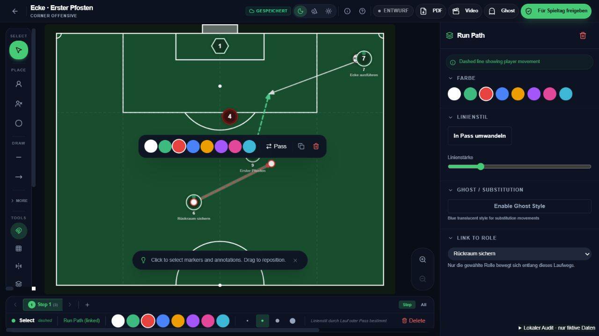
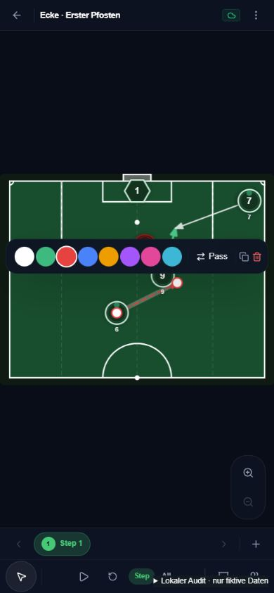

# Editor: Lieferung und weitere Agentenaufträge

Stand: 04.11.2026. Grundlage: [Audit vom 31.10.](EDITOR-AUDIT-2026-10-31.md). Arbeitszweig: `improve/editor-workflow`.

## Rollen und tatsächlich gewählte Modelle

| Rolle | Modell | Thinking | Auftrag |
| --- | --- | --- | --- |
| Alex | Modell der laufenden Hauptsitzung | Einstellung der Hauptsitzung | Integration, Produktgrenzen, Browserabnahme und Lieferstatus |
| Mia | GPT-6.1 Terra | High | Abgegrenzte UI-Korrekturen: Kontrast, Farben, Trefferflächen, Werkzeugbeschriftungen |
| Nora | GPT-6.1 Sol | High | Zeichenlogik, Einrasten, Bindungen, Undo, konsistente Animationspfade |
| Leo | GPT-6 Astra | High | Unabhängiger Review, Regressionen und Konsistenz von Editor/Spieler/Export |

Die drei Fachagenten wurden mit diesen Modell- und Thinking-Parametern gestartet. Je Datei war ein Autor zuständig. Leo fand zusätzliche Fehler bei Marker-Hit-Testing, Kopien, Undo und Fokus; diese wurden integriert. Die erneuten Abschlussaufrufe scheiterten am Nutzungslimit. Die abschliessende Integration und Browserprüfung führte deshalb Alex selbst durch; ein zusätzlicher erfolgreicher Agentenreview wird nicht behauptet.

Die Auswahl ist eine auf den Auftrag bezogene Abwägung. Die offiziellen Hinweise beschreiben Terra für begrenzte Codekorrekturen/visuelle Arbeit, Sol für komplexere kostensensitive Arbeiten und Astra für anspruchsvolle Gesamtprüfungen. Es wurde kein eigener Modellbenchmark durchgeführt. [OpenAI: Modellauswahl](https://developers.openai.com/api/docs/guides/model-selection), [verfügbare Modellrollen](https://learn.chatgpt.com/docs/models).

## Erste Lieferung: umgesetzt

- Ausgewählte gerade und gebogene Linien lassen sich als Ganzes verschieben. Verschiebung am Feldrand erhält die Form.
- Gerade Lauf-/Passlinien lassen sich ziehen oder mit Start-/Zielklick zeichnen, auch direkt an Markern. Nach Abschluss ist die neue Linie ausgewählt; Esc wechselt zur Auswahl.
- Auswahlgriffe liegen über den Spielern. Ein am Spieler gebundener Endpunkt kann dadurch gelöst werden, ohne den Spieler mitzuziehen. Die schwebende Leiste hält Abstand zu den Griffen.
- Untere Leiste, schwebende Leiste und Inspektor bearbeiten die gewählte Linie konsistent. Ohne Auswahl gelten Farben für neue Zeichnungen. Umwandlungen und Kopien berücksichtigen Undo; Kopien behalten keine alten geometrischen Bindungen.
- Einrasten aus verhindert automatische neue Bindungen; bewusste Endpunktkorrektur löst nur die betroffene Bindung.
- Spieler und übrige Wege bleiben beim Bearbeiten sichtbar. Eigene Marker besitzen eine helle Kontur. Farbtasten und mobiler Werkzeugzugriff sind benannt.
- Werkzeuge zeigen Kürzel; die Hilfe erklärt sie. Eingaben, Dialoge und native Schaltflächenaktivierung sind geschützt; Undo/Redo normalisiert Gross-/Kleinschreibung. Ctrl/Cmd+D dupliziert eine gewählte Annotation oder Entität.
- Freie Skizzen bewegen keinen über Listenposition zufällig ausgewählten Spieler mehr. Editor, Spieleransicht und Offscreen-Export verwenden dieselbe explizite Rollenpfadzuordnung. Bestehende ungebundene Wege bleiben sichtbar und können im Inspektor einer Rolle zugeordnet werden.

Noch offen innerhalb des Bedienausbaus: Pfeiltastenverschiebung eigener Rollen. Dafür braucht die erste Phase einen synchronen lokalen Positionsstand und geordnete API-Schreibvorgänge; ein schneller Tastendruck darf keine veraltete Position erneut speichern. Die Hilfe verspricht deshalb nur Linien, Gegner und Ball.

## Abnahmebelege

Abschlusslauf am 04.11. nach den letzten Integrationskorrekturen: 90 Tests, davon 89 erfolgreich und ein bewusst übersprungener PostgreSQL-Test; keine Fehler. Der vollständige Produktionsbuild einschliesslich Typecheck war erfolgreich (Frontend-Build 54,43 Sekunden). Impeccable-Detektor auf den geänderten TSX-Dateien: keine gemeldeten Befunde. Tests verwenden ausschliesslich fiktive Daten; es wurde keine Produktionsdatenbank beschrieben. Protokolle ausserhalb Git: editor-tests-2026-11-04.log und editor-build-2026-11-04.log im Arbeitsordner.

Browserprüfung am 04.11. mit dem echten Editor und In-Memory-API:

| Fall | Beobachtetes Ergebnis |
| --- | --- |
| Lauf von Spieler 9 ziehen | Neue gebundene Linie, leere Zeichenpunkte, Auswahlmodus |
| Ausgewählten Linienkörper ziehen | Beide Punkte werden gemeinsam verschoben; Anker werden gelöst |
| Untere Farbauswahl | Gewählte Linie wird rot; ein Undo stellt nur die Farbe zurück |
| Undo/Redo der Verschiebung | Ein Schritt stellt beide vorherigen Punkte wieder her; Ctrl+Shift+Z stellt die Verschiebung erneut her |
| Zweiklick zwischen Spieler 6 und 9 | Start an Rolle 6 und Ende an Rolle 9 gebunden |
| Endpunkt an Spieler 9 lösen | Endpunkt verschoben, Endbindung entfernt, Spieler und anderer Laufweg unverändert |
| Hilfe öffnen, R und Delete drücken | Keine neue Zeichnung, keine Löschung; gewählte Farbe und drei Annotationen erhalten |
| Smartphonebreite 390 px | Kein horizontaler Dokumentüberlauf; Farben, Auswahlgriffe und Werkzeugmenü sichtbar |

Die letzte mobile Ziehgeste konnte nach Wegfall der Browsersteuerung nicht abschliessend abgenommen werden. Keine physische Touch-, Stift-, iOS-/Android- oder Outdoor-Abnahme. Die beim Test gesetzte Viewportbreite konnte nach dem Werkzeugwegfall nicht mehr zurückgesetzt werden. Der lokale Server wird am Ende beendet.

## Nächster Auftrag: unabhängige Varianten und Phasen

Verantwortlich: Nora für Datenvertrag/Server, Mia für Variantenwähler, Leo für unabhängige Migration-/Zugriffs-/Exportprüfung, Alex für Integration. Für diese anspruchsvolle Datenänderung Nora zunächst Sol High; bei konkreten ungelösten Architekturfragen gezielt Astra Extra High hinzunehmen. Keine dauerhafte Agentenkette und kein Max/Ultra als pauschale Vorgabe.

1. Board-Schema versionieren. Stabile Rollen- und Entitätsidentitäten erhalten; Variante enthält ID, Name, Gegnerhinweis, Teamsignal, Rollenaufträge und Phasen.
2. Jede Phase besitzt vollständige Positionen aller Rollen, Gegner, Torwarte und Bälle sowie eigene Annotationen. Gegnerreaktionen dürfen nicht global die Ausgangslage überschreiben.
3. Variante kopieren: Rollen-/Entitätsidentität erhalten, Varianten-/Phasen-/Annotations-IDs neu erzeugen, Werte tief kopieren. Keine gemeinsam veränderbaren Referenzen.
4. Bestehende Steps verlustfrei in Variante A übernehmen. Globale Entitätspositionen zunächst identisch in jede Phase kopieren; bestehende Daten nicht umdeuten oder löschen.
5. Playback, Spieleransicht, Teilen, PDF und Video erhalten Variante, Phase und Inhaltsversion. «Alle Phasen» bleibt in der aktiven Variante.
6. Veröffentlichung mit Inhaltsversion und Pflichtvarianten. Quiz/Bestätigung an Spieler, Standard, Variante und Version binden. Alte Bestätigungen nicht auf neue Alternativen übertragen. Team/Rolle/Version weiterhin serverseitig prüfen.

Abnahme: A nach B kopieren; Gegner, Lauf und Auftrag in B ändern; A bleibt identisch. Danach Undo, Speichern/Neuladen sowie Spieleransicht und Export prüfen. Antwort für A bestätigt B nicht. Relevante Änderungen öffnen die betroffene Pflichtvariante wieder.

## Danach: Signalfiguren

Mia gestaltet wenige Vektorposen/Abzeichen: ein Arm, beide Arme, zeigen und Blickrichtung. Nora ergänzt optionale Pose, Richtung und frei benennbaren Teamtext je Rolle/Phase. Spielernummer und Identität bleiben lesbar; Spiegelung und alle Ausgabekanäle verwenden dieselbe Geometrie. Gegnerhinweis und vereinbartes Teamsignal bleiben getrennte Begriffe.

Mit den fünf Trainern dieselben Aufgaben vor/nach dem Ausbau prüfen: aus Vorlage zeichnen, Linie ändern, Undo, Variante kopieren, Gegnerreaktion erklären und Spieleransicht öffnen. Zeiten, Hilferufe und unbeabsichtigte Änderungen erfassen. Die im Audit genannten Zeiten sind Produktziele, keine bisher gemessenen Pilotresultate.

## Auslieferung und Budget

Erste Lieferung: [PR #6 als Entwurf](https://github.com/PerformIQ-GmbH/setpiece/pull/6), Implementierungscommit `664ee9c9b0194bd5224a62280ede969b37ce54c3`. GitHub prüft Linux und Windows. Implementiert und lokal geprüft bedeutet noch keinen neuen Live-Release. Merge, CI, Replit-Deployment und öffentliche Abnahme separat in STATUS nachtragen. Keine neue Schemaänderung in dieser ersten Lieferung. Kein bezahlter Replit-Agentauftrag, kein Ads-Kauf und keine neue Aufladung für diese Etappe.

Die gstack-Startskripte sind in der lokalen Installation unvollständig. Die vorhandene Review-Checkliste wurde gelesen; Diff, unabhängige Agentenbefunde, Tests und Browserbelege werden direkt geprüft. Keine neue Skillinstallation als Nebenarbeit und keine Behauptung eines vollständig gelaufenen gstack-Automatikworkflows.
